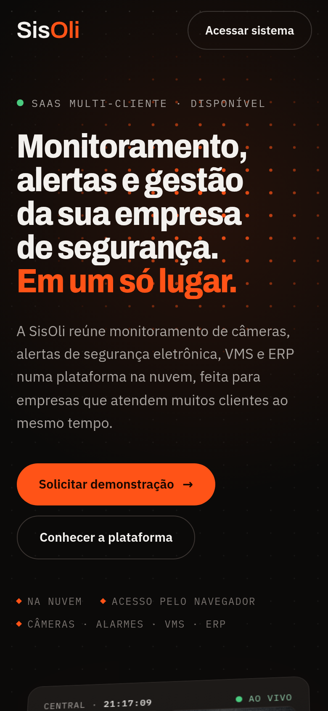

<h1 align="center">SisOli · Site institucional</h1>

<p align="center">
  Landing page da <strong>SisOli Gestão Empresarial</strong>: monitoramento de câmeras, alertas de segurança eletrônica, VMS e ERP para empresas de segurança, numa plataforma SaaS multi-cliente.
</p>

<p align="center">
  
  
  
  
  
</p>

<p align="center">
  <a href="https://ROBs788.github.io/sisoli-site/"><strong>Ver o site ao vivo »</strong></a>
</p>


---

## Sumário

- [Sobre o projeto](#sobre-o-projeto)
- [Destaques](#destaques)
- [Tecnologias](#tecnologias)
- [Estrutura do repositório](#estrutura-do-repositório)
- [Como rodar localmente](#como-rodar-localmente)
- [Publicar no GitHub Pages](#publicar-no-github-pages)
- [Personalização](#personalização)
- [Seções da página](#seções-da-página)
- [Efeitos e animações](#efeitos-e-animações)
- [Acessibilidade e desempenho](#acessibilidade-e-desempenho)
- [Pendências antes de ir ao ar](#pendências-antes-de-ir-ao-ar)
- [Licença](#licença)

---

## Sobre o projeto

Site de página única que apresenta a plataforma da SisOli. O visual lembra uma sala de controle: fundo escuro, o laranja da marca como destaque e uma central de monitoramento "ao vivo" logo no topo.

O projeto é **um único arquivo `index.html`** com HTML, CSS e JavaScript juntos. Não há etapa de build, gerenciador de pacotes ou framework. Basta abrir o arquivo no navegador ou hospedá-lo em qualquer servidor estático.

<p align="center">
  
</p>

## Destaques

- **Central de monitoramento simulada**: 6 câmeras desenhadas em `<canvas>` com ruído de imagem, pessoas em movimento, relógio em tempo real e detecção "PESSOA" na câmera em alerta.
- **Alerta interativo**: o botão *Atender* muda a ocorrência para "em atendimento" e de volta.
- **Rolagem suave** em toda a página com [Lenis](https://github.com/darkroomengineering/lenis).
- **Seção horizontal fixada**: na Plataforma, a tela trava e os 4 módulos passam na horizontal conforme o scroll.
- **Tipografia animada**: títulos que entram palavra por palavra e uma logo gigante que muda de largura (fonte variável).
- **Responsivo**: layout próprio para celular, sem rolagem horizontal.
- **Respeita "reduzir movimento"**: quem ativa essa opção no sistema vê a página completa, sem animações.

## Tecnologias

| Recurso | Uso | Origem |
| --- | --- | --- |
| HTML5 + CSS3 | Estrutura, layout (Grid/Flexbox) e tokens de cor em variáveis CSS | — |
| JavaScript (ES5+) | Câmeras em canvas, interações, formulário | — |
| [GSAP 3.12.5](https://gsap.com/) + ScrollTrigger | Animações de entrada e ligadas ao scroll | cdnjs |
| [Lenis 1.1.13](https://github.com/darkroomengineering/lenis) | Rolagem suave | jsDelivr |
| [Archivo](https://fonts.google.com/specimen/Archivo) (variável) | Títulos e logo | Google Fonts |
| [IBM Plex Sans](https://fonts.google.com/specimen/IBM+Plex+Sans) | Texto corrido | Google Fonts |
| [IBM Plex Mono](https://fonts.google.com/specimen/IBM+Plex+Mono) | Rótulos técnicos (câmeras, horários) | Google Fonts |

Todas as dependências vêm de CDN com versão fixa. Se alguma não carregar, a página continua funcionando: o conteúdo aparece completo, só sem as animações de scroll.

## Estrutura do repositório

```
.
├── index.html        # o site inteiro (HTML + CSS + JS)
├── docs/
│   ├── preview.png   # captura de tela do desktop (usada neste README)
│   └── mobile.png    # captura de tela do celular
├── .nojekyll         # faz o GitHub Pages servir os arquivos como estão
└── README.md
```

Dentro do `index.html`, o código segue esta ordem:

1. `<head>`: metadados, fontes e todo o CSS (tokens em `:root` no topo).
2. `<body>`: barra de progresso, navegação, seções da página e rodapé.
3. Scripts: GSAP, ScrollTrigger, Lenis e o script da página no final.

## Como rodar localmente

Você pode abrir o `index.html` direto no navegador (duplo clique). Para testar como vai ficar hospedado, suba um servidor local:

```bash
# com Python
python3 -m http.server 8080

# ou com Node
npx serve .
```

Depois acesse `http://localhost:8080`.

## Publicar no GitHub Pages

1. Crie um repositório no GitHub e envie os arquivos:

   ```bash
   git init
   git add .
   git commit -m "Site institucional SisOli"
   git branch -M main
   git remote add origin https://github.com/ROBs788/sisoli-site.git
   git push -u origin main
   ```

2. No repositório, vá em **Settings → Pages**.
3. Em **Build and deployment**, escolha **Deploy from a branch**, branch `main` e pasta `/ (root)`. Clique em **Save**.
4. Em um ou dois minutos o site fica disponível em `https://ROBs788.github.io/sisoli-site/`.

### Usar o domínio próprio (sisoli.com.br)

1. Em **Settings → Pages → Custom domain**, informe `www.sisoli.com.br` e salve. O GitHub cria um arquivo `CNAME` no repositório.
2. No painel de DNS do domínio, crie um registro **CNAME** de `www` apontando para `ROBs788.github.io`.
3. Para o domínio sem `www`, crie registros **A** apontando para os IPs do GitHub Pages: `185.199.108.153`, `185.199.109.153`, `185.199.110.153` e `185.199.111.153`.
4. Depois que o DNS propagar, marque **Enforce HTTPS**.

> ⚠️ Hoje `www.sisoli.com.br` é o endereço do sistema em produção. Se o site institucional for ocupar esse domínio, combine antes para onde o sistema vai (por exemplo, `app.sisoli.com.br`) e atualize os links "Acessar sistema" no `index.html`.

## Personalização

### Cores

Todas as cores estão como variáveis no bloco `:root`, no início do CSS. As principais:

| Variável | Valor | Uso |
| --- | --- | --- |
| `--accent` | `#FF5317` | Laranja da marca: botões, destaques, "Oli" da logo |
| `--accent-2` | `#FF7A45` | Laranja no hover dos botões |
| `--bg` | `#0B0A09` | Fundo principal |
| `--panel` | `#171514` | Fundo de cartões e painéis |
| `--fg` | `#F3F1EE` | Texto principal |
| `--muted` | `#A8A39F` | Texto secundário |
| `--live` | `#4ACB7F` | Indicador "ao vivo" e itens confirmados |

O laranja também aparece em alguns pontos fora das variáveis (gradiente do diagrama multi-cliente e desenho das câmeras no JavaScript). Para trocar a cor da marca, busque por `FF5317` e `255,83,23` no arquivo.

### Textos

Todo o texto está direto no HTML, em português. Basta editar o conteúdo das seções.

### Logo

A logo é feita em texto (`Sis<b>Oli</b>`) com a fonte Archivo, para ficar nítida em qualquer tamanho. Para usar o arquivo oficial, troque os elementos com a classe `.logo` por um ``.

### Formulário de contato

O formulário **não envia dados**: hoje ele só valida os campos e mostra uma mensagem na tela. Como o GitHub Pages só hospeda arquivos estáticos, use um serviço externo. Por exemplo, com o [Formspree](https://formspree.io/):

1. Crie um formulário no Formspree e copie o endpoint (`https://formspree.io/f/xxxxxxx`).
2. No script do `index.html`, troque o bloco do formulário (`$('#demoForm').addEventListener('submit', ...)`) por:

   ```js
   $('#demoForm').addEventListener('submit', async function (e) {
     e.preventDefault();
     var st = $('#status');
     var res = await fetch('https://formspree.io/f/xxxxxxx', {
       method: 'POST',
       headers: { 'Accept': 'application/json' },
       body: new FormData(e.target)
     });
     st.textContent = res.ok
       ? 'Recebemos seu pedido. Entraremos em contato em breve.'
       : 'Não foi possível enviar agora. Tente de novo ou fale pelo WhatsApp.';
   });
   ```

Outra opção é enviar direto para o WhatsApp, abrindo `https://wa.me/55DDDNUMERO?text=...` com os dados preenchidos.

## Seções da página

| Âncora | Seção | Conteúdo |
| --- | --- | --- |
| `#topo` | Hero | Título, chamada para demonstração e a central de monitoramento simulada |
| — | Faixa | "Monitoramento · Alertas · VMS · ERP" em movimento contínuo |
| `#plataforma` | A plataforma | Os 4 módulos: câmeras, alertas, VMS e ERP, cada um com uma prévia animada |
| `#multicliente` | Multi-cliente | Diagrama da central conectada a clientes de vários segmentos |
| `#como-funciona` | Como funciona | Três passos: cadastrar, conectar, monitorar |
| `#contato` | Contato | Dados de contato e formulário de demonstração |

As âncoras funcionam como links diretos, por exemplo `https://www.sisoli.com.br/#contato`.

## Efeitos e animações

| Efeito | Onde | Como funciona |
| --- | --- | --- |
| Entrada do título | Hero | Cada palavra sobe de dentro de uma máscara (GSAP timeline) |
| Grade de pontos + varredura | Fundo do hero | Canvas que acende os pontos perto do cursor |
| Inclinação 3D da central | Hero | Segue o mouse; ao rolar, a central se endireita |
| Câmeras ao vivo | Hero e Plataforma | Cenas procedurais em canvas, pausadas quando fora da tela |
| Barra de progresso | Topo da página | Cresce conforme a rolagem |
| Faixa com velocidade | Após o hero | Acelera e inverte a direção conforme a velocidade do scroll |
| Scroll horizontal fixado | Plataforma (telas ≥ 900px) | ScrollTrigger com `pin` e `containerAnimation` |
| Títulos que acendem | Títulos das seções | Opacidade palavra por palavra ligada ao scroll |
| Linhas que se desenham | Multi-cliente | `stroke-dashoffset` do SVG ligado ao scroll |
| Linha de progresso dos passos | Como funciona | Preenche e ativa cada número em sequência |
| Logo que se expande | Contato | Eixo de largura (`wdth`) da fonte variável ligado ao scroll |
| Botões magnéticos | Chamadas principais | Seguem levemente o cursor (apenas mouse) |

## Acessibilidade e desempenho

- Com **`prefers-reduced-motion`** ativo, animações e rolagem suave são desligadas e todo o conteúdo aparece estático.
- Todo o conteúdo fica visível mesmo sem JavaScript ou se as bibliotecas não carregarem.
- Controles reais (`<button>`, `<a>`, `<label>` + `<input>`), foco visível pelo teclado e áreas de toque de pelo menos 44px.
- Elementos decorativos marcados com `aria-hidden`; a central simulada e o diagrama têm descrição para leitores de tela.
- As câmeras em canvas só são redesenhadas quando estão visíveis e rodam a cerca de 16 quadros por segundo, para poupar bateria.
- Nenhuma imagem externa: o arquivo inteiro tem cerca de 50 KB.

## Pendências antes de ir ao ar

Procure por `[` no `index.html` para achar os pontos a preencher:

- [ ] WhatsApp: `[SEU NÚMERO]`
- [ ] E-mail: `[SEU E-MAIL]`
- [ ] Cidade/UF: `[CIDADE / UF]`
- [ ] CNPJ no rodapé: `[00.000.000/0000-00]`
- [ ] Nome do cliente no exemplo de contrato do ERP: `[Cliente]`
- [ ] Ligar o formulário a um serviço de envio (veja [Formulário de contato](#formulário-de-contato))
- [ ] Definir o endereço do sistema e atualizar os links "Acessar sistema"
- [ ] (Opcional) Adicionar favicon e imagem de compartilhamento (`og:image`)

## Licença

© 2026 SisOli Gestão Empresarial. Todos os direitos reservados.

<!-- Se quiser abrir o código, troque esta seção por uma licença (por exemplo, MIT) e adicione o arquivo LICENSE. -->
